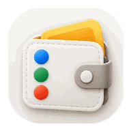
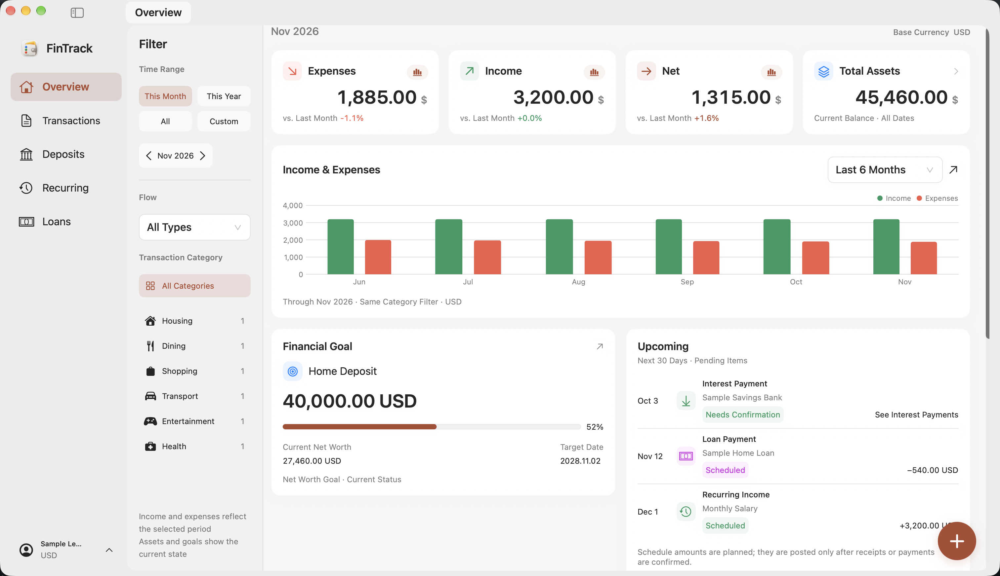

  

<h1 align="center">FinTrack</h1>

A personal finance workspace built for Mac. Track transactions, organize your finances, and plan with clarity.

<strong>v1.5 · macOS 15.0+ · Apple Silicon / Intel</strong>

  <a href="https://agumuzi.github.io/FinTrack/">Website</a> ·
  <a href="https://github.com/Agumuzi/FinTrack/releases/tag/v1.5">Download for macOS</a> ·
  <a href="docs/INSTALLATION.md">Installation</a> ·
  <a href="CHANGELOG.md">Changelog</a> ·
  <a href="https://ko-fi.com/agumuzi">Support development</a>

<strong>English</strong> · <a href="README.zh-CN.md">Simplified Chinese</a>

<picture>
  <source media="(prefers-color-scheme: dark)" srcset="website/assets/screenshots/overview-dark.png">
  
</picture>

*Actual application screenshots with fictional sample data. No sample ledger is included with the app.*

## Your personal finances, all in one workspace

- **Income and expenses:** Record and find transactions by date, category, and currency. Categories follow the transaction type; entries retain their original amounts and historical exchange rates. Explore trends and category breakdowns.
- **Assets and planning:** Manage accounts, assets, deposits, loans, recurring transactions, budgets, and financial goals. Upload your own bank images; FinTrack associates them with bank names and reuses them automatically when the same name is entered.
- **Deposit interest overview:** Review expected interest, current-year received and pending interest, and future-year projections grouped by the original currency. Unverified scheduled income is not treated as confirmed receipt.
- **Multiple currencies:** Preserve original-currency amounts, recorded exchange rates, and base-currency values. Look up and convert currencies, with separate rate-source preferences for bookkeeping and menu-bar monitoring.
- **Native Mac experience:** SwiftUI interface, menu-bar shortcuts, keyboard interaction, and light/dark appearance. Choose installed macOS fonts, adjust text size and interface scaling, and configure login launch and background operation.
- **Selected-amount conversion:** Select an amount in another app and convert it using a global shortcut, with optional automatic display on selection. Requires macOS Accessibility permission.
- **Local data management:** Full native backup and restore, plus four CSV formats for import and export.
- **Interface languages:** English and Simplified Chinese, with a Follow System option and in-app language switching. Russian translation resources are retained but are not yet available as a selectable language.

See more real screenshots on the [product website](https://agumuzi.github.io/FinTrack/#showcase).

## Download and install

[**Download FinTrack v1.5 for macOS**](https://github.com/Agumuzi/FinTrack/releases/download/v1.5/FinTrack-v1.5-macOS.dmg) · [SHA256 checksums](https://github.com/Agumuzi/FinTrack/releases/download/v1.5/SHA256.txt)

1. Download the DMG and verify its checksum. Open it, then drag `FinTrack` into the `Applications` folder shown alongside it.
2. On first launch, macOS may block the app under its security checks. The current distribution uses a **fixed local signing identity and is not notarized by Apple**. See the [installation guide](docs/INSTALLATION.md).
3. The first launch offers a permissions walkthrough; you can skip it and reopen it later in General settings. Start with a few test entries, verify persistence after restarting, and test backup and restore before relying on the app for everyday finances.

Versions v1.1 and later include an official signed update feed. Use **Settings → About FinTrack** to check for updates, download and verify them, and then confirm installation. Users upgrading from v1.0 must manually install the current release. Create a full backup before upgrading. If in-app downloading times out, use the links above to download and verify the release manually.

**Requirements:** macOS 15.0 or later. The distribution includes both arm64 and x86_64. It has been run on physical Apple Silicon hardware; Intel hardware compatibility has not yet been verified on a physical device.

## Data and privacy

Financial records are stored locally, separately from the application bundle and source tree. You enter your own information, choose your own images, and can create full backups. API keys are stored in the macOS Keychain and are **not** transferred with ledger backups.

Exchange-rate requests contact your selected external providers. Backups and CSV files can contain sensitive financial information and should be protected. FinTrack is **not an encrypted vault**. For details, see [Data & Privacy](docs/PRIVACY.md).

## Project documentation

| Document | Contents |
| --- | --- |
| [Documentation index](docs/README.md) | Find guides for users, contributors, and code maintainers |
| [Build guide](docs/BUILDING.md) | Requirements, compilation, and project generation |
| [Architecture](docs/ARCHITECTURE.md) | Entry points, feature modules, shared models, and resources |
| [Installation](docs/INSTALLATION.md) | Installation, checksum verification, and secure updates |
| [Changelog](CHANGELOG.md) | Published application versions |
| [Contributing](CONTRIBUTING.md) | Reporting issues and proposing changes |
| [Security policy](SECURITY.md) | Private vulnerability reports and handling sensitive information |
| [Code of conduct](CODE_OF_CONDUCT.md) | Conduct in issues, pull requests, and discussions |
| [Third-party notices](docs/THIRD_PARTY_NOTICES.md) | Platform components and asset provenance |

Update via [GitHub Releases](https://github.com/Agumuzi/FinTrack/releases) or the built-in signed update feed available since v1.1. Full VoiceOver coverage, prolonged real-world financial use, and physical Intel testing remain unverified.

## License and brand assets

The original source code that the maintainer has the right to license is distributed under the [MIT License](LICENSE), which permits use, copying, modification, distribution, and commercial use subject to retaining the copyright and license notice. The software is provided **as is**, without warranty.

**The FinTrack app icon, Agumuzi branding, original promotional graphics, and screenshots** are not licensed under MIT for separate reuse. They must not be repurposed as another project's branding or artwork without permission, except as permitted by law. See the [Brand & Visual Assets notice](ASSETS-LICENSE.md). Third-party assets and platform components remain subject to their respective terms; see [Third-party notices](docs/THIRD_PARTY_NOTICES.md).

**License history:** Previous releases used different licensing terms, and rights already granted by those releases are not retroactively withdrawn. An earlier MIT license text remains archived in the [legacy license document](docs/LEGACY_MIT_LICENSE.md). Contact the maintainer through this repository for permission to reuse brand artwork.
