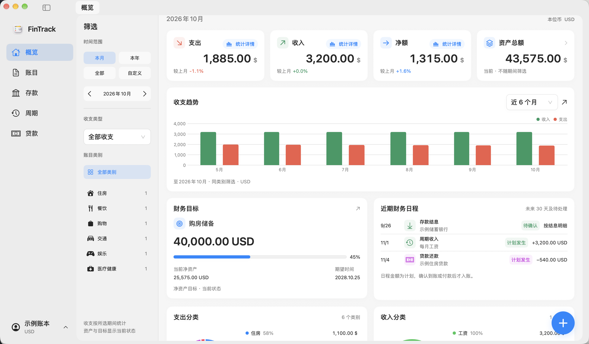

  

<h1 align="center">FinTrack</h1>

为 Mac 打造的个人财务工作台。记录收支，整理资产，把计划看清楚。

<strong>v1.4 · macOS 15.0+ · Apple Silicon / Intel</strong>

  <a href="https://agumuzi.github.io/FinTrack/">产品官网</a> ·
  <a href="https://github.com/Agumuzi/FinTrack/releases/tag/v1.4">下载 macOS 版</a> ·
  <a href="docs/INSTALLATION.md">安装指南</a> ·
  <a href="CHANGELOG.md">更新记录</a>

<picture>
  <source media="(prefers-color-scheme: dark)" srcset="website/assets/screenshots/overview-dark.png">
  
</picture>

*真实软件界面，使用示例数据展示。应用不预装示例账本。*

## 在一个工作台里，整理个人财务

- **日常记账**：管理收入与支出，按日期、类别和币种查找；类别跟随收支范围，明细保留原币与历史汇率，查看趋势与分类统计。
- **资产与计划**：整理账户与资产，管理存款、贷款、周期记账、预算及财务目标。银行图片支持自行上传，与银行名称关联保存；再次输入相同名称会自动匹配，无需重复添加。
- **多币种**：保留原币、记账汇率和本位币金额，查询与换算汇率，分别选择记账及菜单栏的数据来源。
- **Mac 原生体验**：SwiftUI 界面、菜单栏快速操作、键盘交互与浅色 / 深色外观；支持从 macOS 字体库选择界面字体。
- **本地数据管理**：原生完整备份与恢复，四类 CSV 模板及导入导出。

更多真实界面见[产品官网](https://agumuzi.github.io/FinTrack/#showcase)。

## 下载与安装

[**下载 FinTrack v1.4 for macOS**](https://github.com/Agumuzi/FinTrack/releases/download/v1.4/FinTrack-v1.4-macOS.zip) · [SHA256 校验文件](https://github.com/Agumuzi/FinTrack/releases/download/v1.4/SHA256.txt)

1. 下载并校验 ZIP，解压后将 `FinTrack.app` 拖入“应用程序”。
2. 首次打开可能受到 macOS 安全检查限制。当前安装包采用 **固定本地身份签名，未经 Apple 公证**，详见[安装指南](docs/INSTALLATION.md)。
3. 先录入少量数据，确认保存、退出重开和备份恢复符合需要，再逐步投入日常使用。

v1.1 及之后版本内置官方签名更新源，可在“设置 → 关于 FinTrack”中检查、下载并校验新版，再确认安装。v1.0 用户需手动下载当前版本并替换应用。升级前请先创建完整备份。应用内下载如遇网络超时，可使用上方链接手动下载并校验。

需要 **macOS 15.0 或更高版本**。安装包包含 arm64 与 x86_64；已在 Apple Silicon 实机运行，Intel 实机兼容性尚未验证。

## 数据与隐私

账本保存在本机，与应用和源代码目录分开。用户自行录入数据、选择图片，并通过完整备份保存账本。API 密钥使用本机钥匙串，不随账本备份迁移。

汇率查询会连接所选的外部数据来源；备份和 CSV 包含财务信息，应妥善保管。账本不是加密保险库。更多细节见[数据与隐私](docs/PRIVACY.md)。

## 项目与文档

| 文档 | 内容 |
| --- | --- |
| [构建指南](docs/BUILDING.md) | 环境要求、源码编译与工程生成 |
| [源码结构](docs/ARCHITECTURE.md) | 应用入口、业务模块、共享模型和资源 |
| [安装指南](docs/INSTALLATION.md) | 安装、校验与安全更新 |
| [更新记录](CHANGELOG.md) | 正式应用版本 |
| [参与项目](CONTRIBUTING.md) | 反馈问题和提交改动 |
| [安全政策](SECURITY.md) | 私密报告安全问题与敏感信息处理 |
| [素材与组件](docs/THIRD_PARTY_NOTICES.md) | 平台组件及资源来源 |

可通过 [GitHub Releases](https://github.com/Agumuzi/FinTrack/releases) 手动更新，或使用 v1.1 起内置的官方签名更新源。完整 VoiceOver、长期真实财务使用和 Intel 实机仍待验证。

## 许可证

FinTrack 采用 [MIT 许可证](LICENSE)。第三方素材和平台组件遵循各自条款，参见[素材与组件说明](docs/THIRD_PARTY_NOTICES.md)。
